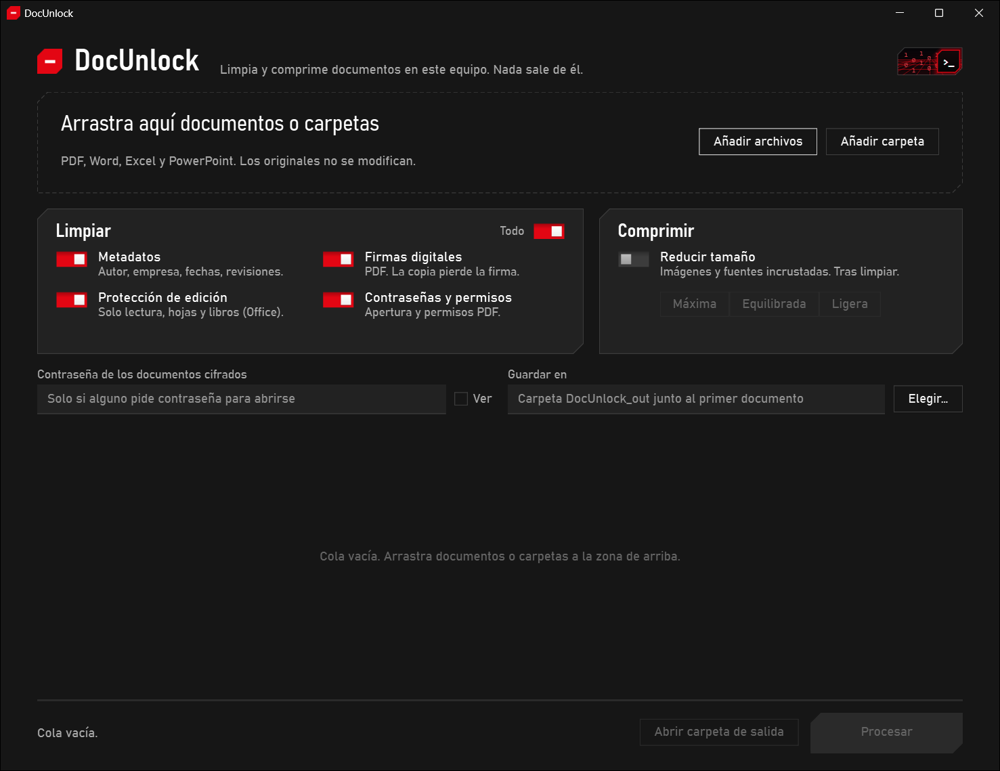

<!--
[ES] DocUnlock: quita protecciones, permisos, firmas y metadatos de PDF y Office, y opcionalmente comprime. Todo local, sin admin.
[EN] DocUnlock: strips protections, permissions, signatures and metadata from PDF and Office files, and can compress. Local only, no admin.
Contexto: usuario
Instalar: $f="$env:TEMP\DocUnlock.exe"; [Net.ServicePointManager]::SecurityProtocol=3072; irm https://github.com/4leX-42/DocUnlock/releases/latest/download/DocUnlock.exe -OutFile $f; explorer.exe "$f"
-->
<div align="center">

# DocUnlock

Limpieza y compresión local de PDF y Office. Sin admin, sin red.

  



<sub>Parte de <a href="https://github.com/4leX-42/GADGETS-SUPPORT_CX">GADGETS-SUPPORT_CX</a></sub>

</div>

##  Instalar

```powershell
$f="$env:TEMP\DocUnlock.exe"; [Net.ServicePointManager]::SecurityProtocol=3072; irm https://github.com/4leX-42/DocUnlock/releases/latest/download/DocUnlock.exe -OutFile $f; explorer.exe "$f"
```

Se instala en `%LOCALAPPDATA%\Programs\DocUnlock` con acceso en Inicio. Abrir sin elevar: con integridad alta Windows bloquea el arrastrar y soltar.

##  Qué hace

| Formato | Limpia |
|---|---|
|  PDF | Permisos, cifrado de propietario, firmas (`/Sig`, `/Perms`), DocInfo y XMP |
|  `.docx` `.xlsx` `.pptx` | Protección de edición y hoja, `docProps` |
|  Office cifrado | Descifra con la contraseña indicada y limpia |
|  `.doc` `.xls` `.ppt` | Solo descifrado |

 **Comprimir** (opcional, independiente): imágenes a 72 / 150 / 300 ppp, recorte de fuentes incrustadas, deduplicado. Solo se guarda si pesa menos.

 Los originales no se modifican: la salida va a `DocUnlock_out` sin sobrescribir.

>  Sin fuerza bruta: las contraseñas de apertura las aporta el usuario. Quitar una firma la invalida.

##  CLI

```
python main.py <archivos|carpetas> -o <salida> [-p <contraseña>] [-c screen|ebook|printer]
```

`--keep-metadata` `--keep-signatures` `--keep-protection` `--keep-passwords`

<details>
<summary> <b>Desarrollo</b></summary>

```bat
py -3 -m venv .venv && .venv\Scripts\activate
pip install -r requirements.txt
python main.py                              REM GUI
python -m unittest -v tests.test_pipeline   REM pruebas
build.bat                                   REM dist\DocUnlock.exe
```

```
main.py                 entrada GUI / CLI
core/                   detección, pipeline, resultado
processors/             pdf_proc, office_proc, compress, pdf_fonts
gui/app.py              PySide6
tests/                  ficheros sintéticos
```

Formato nuevo: un `Processor` en `processors/` registrado en `Pipeline`. Bloqueos en equipos gestionados (SmartScreen, AppLocker, ASR): `docs/ESTADO-Y-PENDIENTE.md` §4.
</details>
